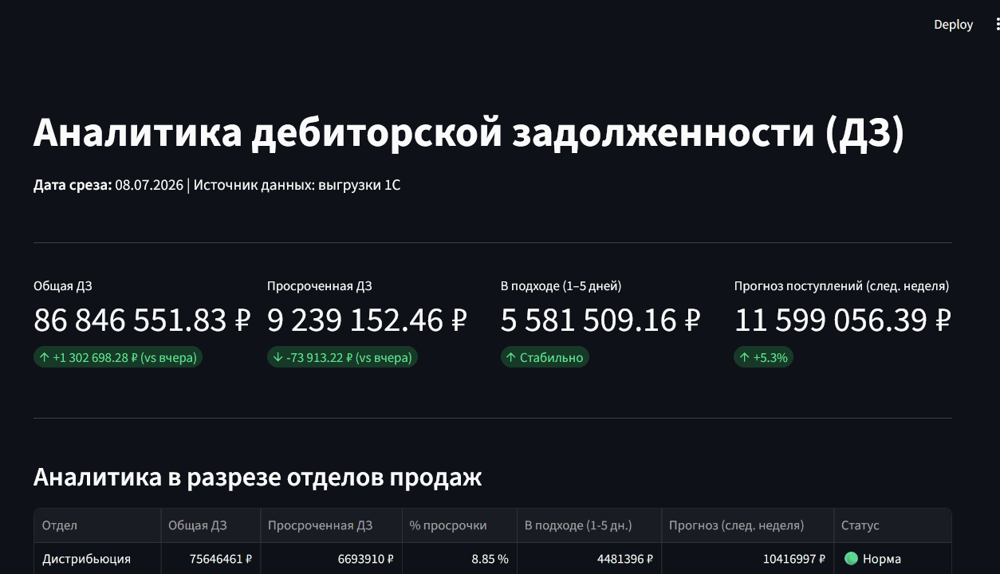

# Веб-дашборд «Аналитика дебиторской задолженности (ДЗ)»

Интерактивное BI-приложение для мониторинга, оценки бизнес-метрик и отслеживания проблемных контрагентов по дебиторской задолженности на основе иерархических выгрузок отчетов из 1С (данные актуальны на срез от **08.07.2026**).


(зеленые метрики просто хардкод)

## Стек технологий
* **Язык разработки:** Python 3.11+
* **Парсинг и ETL:** `openpyxl` (чтение метаданных, стилей и формул оригинального Excel «на лету»)
* **База данных:** SQLite (ANSI SQL / встроенный драйвер `sqlite3`) — обеспечивает запуск «из коробки» без развертывания тяжелых СУБД.
* **Frontend / BI:** `Streamlit` (высокоскоростной реактивный веб-интерфейс).
* **Визуализация:** `Plotly` (интерактивные графики с поддержкой двух независимых осей Y).

---

## Структура проекта
```text
AR_dashboard/
│
├── data/                  # Исходные файлы выгрузок из 1С
│   ├── distribution.xlsx  # Отчет по отделу «Дистрибьюция»
│   └── matching.xlsx      # Отчет по отделу «Комплектация»
│
├── src/                   # Исходный код приложения
│   ├── parser.py          # ETL-скрипт: разбор иерархии 1С и инициализация БД
│   └── app.py             # Код веб-интерфейса дашборда на Streamlit
│
├── requirements.txt       # Список зависимостей проекта
├── debts.db               # Локальная база данных SQLite (генерируется автоматически)
└── README.md              # Документация проекта
```

---

## Инструкция по локальному запуску

### 1. Подготовка окружения
Убедитесь, что исходные файлы отчетов лежат в папке `data/` под именами `distribution.xlsx` и `matching.xlsx`.

### 2. Создание и активация виртуального окружения
* **Windows (PowerShell):**
  ```bash
  python -m venv venv
  .\venv\Scripts\activate
  ```
* **macOS / Linux:**
  ```bash
  python3 -m venv venv
  source venv/bin/activate
  ```

### 3. Установка библиотек
```bash
pip install -r requirements.txt
```

### 4. Парсинг данных и инициализация СУБД
Запустите скрипт для очистки старых таблиц (вообще БД я кинул ни гит), разбора Excel-файлов и наполнения базы данных:
```bash
python src/parser.py
```
*После успешного завершения в корне проекта сгенерируется файл реляционной БД `debts.db`.*

### 5. Запуск веб-панели аналитики
```bash
streamlit run src/app.py
```
*Система автоматически откроет дашборд в браузере по адресу `http://localhost:8501`.*

---

## Архитектурные решения и бизнес-логика

1. **Реляционное хранилище (DWH):** В схему таблицы `customer_debts` заложено обязательное индексируемое поле `snapshot_date`. Это позволяет системе работать в режиме регулярных ETL-задач, накапливая ежедневные снимки (срезы) данных во времени без изменения кодовой базы приложения.
2. **Детерминированный алгоритм парсинга:** Из-за особенностей выгрузки 1С, стандартные библиотеки часто теряют ведущие пробелы или некорректно считывают свойство `cell.alignment.indent`. Разработанный алгоритм использует комбинированный метод **динамического накопления контекста** и текстовых маркеров (`is_client`, `is_contract`, `is_document`, `is_manager`). Скрипт идет по строкам сверху вниз, запоминает текущего «родителя» и при нахождении конечной строки накладной делает плоскую реляционную запись. Это полностью решило проблему смещения уровней, затирания или дублирования менеджеров и контрагентов.
3. **Расчет бизнес-метрик строго по ТЗ:**
   * **В подходе (1-5 дней):** Фильтруются и суммируются накладные, у которых поле `days_to_payment` лежит в диапазоне от 1 до 5 дней включительно.
   * **Прогноз поступлений (след. неделя):** Агрегируются плановые платежи с горизонтом `[1; 7]` дней от даты среза.

---

## Описание использования AI-агентов (Cursor / Claude Code)

Разработка велась по методологии парного программирования совместно с ИИ-ассистентом.

### Процесс взаимодействия и дебаггинга:
* **Проектирование:** Нейросеть помогла быстро спроектировать реляционную схему данных под сложную структуру 1С и оптимизировать SQL-индексы для аналитических запросов.
* **Преодоление ограничений openpyxl:** В первой итерации парсер путал уровни Менеджер/Контрагент из-за того, что Excel-свойство `indent` возвращало нули. С помощью ИИ-агента логика была успешно переписана на контекстный анализ текстовых сущностей методом исключения.
* **Обеспечение 100% сходимости цифр:** При сверке итоговых сумм выявилась нехватка 8 070 ₽ в отделе Дистрибьюции. С помощью ИИ-ассистента оперативно локализовали проблему — строка относилась к редкому типу документов «Взаимозачет». В список маркеров парсера было добавлено ключевое слово `"взаимозачет"`, что позволило свести финансовый баланс ДЗ копейка в копейку с оригиналом 1С (**86 846 551.83 ₽**).

### Ключевые использованные промпты:
1. *«Изучи структуру иерархического отчета 1С "Задолженность клиентов по срокам". Напиши отказоустойчивый алгоритм на Python, который сможет восстановить цепочку Менеджер -> Контрагент -> Договор -> Документ, если все они идут друг за другом в первом столбце Excel.»*
2. *«Исправь ошибку логики: openpyxl обрезает пробелы в ячейках, из-за чего ломается счетчик отступов. Менеджеры и контрагенты заменяются на дефолтные заглушки. Перепиши логику на накопление контекста через текстовые маркеры (ООО, ИП, Договор, Реализация) методом исключения.»*

